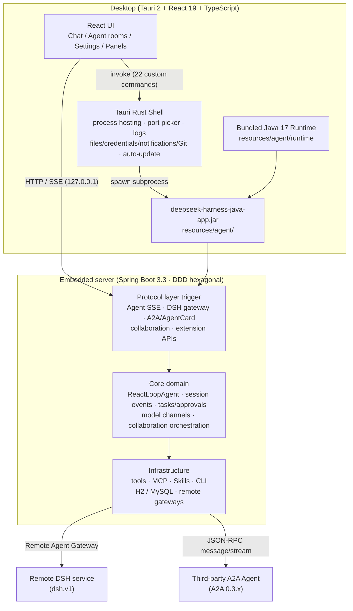
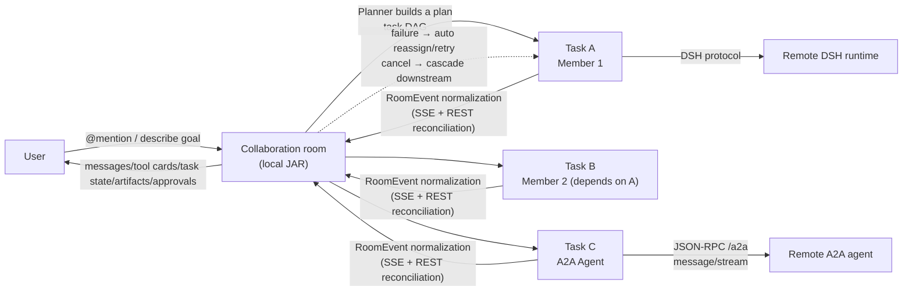

<div align="center">

# DSH Java Desktop

### Digital-Human AI Agent Desktop · Built-in Agent Runtime · Multi-Agent Collaboration · A2A Open Protocol

[](./src-tauri/tauri.conf.json)
[](#-usage)
[](https://tauri.app)
[](./README.md)

</div>

> [**DSH Java Desktop**](https://mp.weixin.qq.com/s/1PVow3-HvItfUvSReGt6wQ) is the desktop workbench for [deepseek-harness-java](https://github.com/fuzhengwei/deepseek-harness-java) (the Agent Runtime server). It is a ready-to-use "digital human" AI agent desktop app — with the DSH Java Agent Runtime built in, it works out of the box with zero external dependencies. A single digital human can handle coding, diagramming, and document work; multiple digital humans form cross-device collaboration teams via dsh.v1 / A2A, extensible with plugins / Skills / MCP / CLI.
>
> The desktop app is just the shell — capabilities live in the server: **TypeScript + React** builds the UI, **Tauri 2** handles windows, process hosting and native capabilities, and agent capabilities are implemented by `deepseek-harness-java`. The shell launches an embedded Spring Boot JAR and talks to it over local `127.0.0.1` HTTP/SSE APIs.

---

## 📑 Table of Contents

- [Usage](#-usage)
- [How It Works](#️-how-it-works)
- [Core Features](#-core-features)
- [Tech Stack](#️-tech-stack)
- [Releases & Auto-Update](#-releases--auto-update)
- [Diagnostics & FAQ](#-diagnostics--faq)
- [Documentation](#-documentation)

---

## 🚀 Usage

### Option 1: Installer (recommended for personal use)

Download the installer for your platform from GitHub Releases:

- GitHub: <https://github.com/fuzhengwei/DSH-Java-Desktop/releases>

| Platform | Architectures |
|:---|:---|
| macOS | Apple Silicon / Intel |
| Windows | x64 |
| Linux | x64 (AppImage / deb / rpm) |

**1. Launch and go.** The app automatically starts its embedded agent service — no JDK or database installation needed (the release bundles Temurin JRE 17 and a local H2 database; data lives in the app data directory).

**2. Confirm the service is ready.** Open Settings (bottom-left) → Agent Service Connection.

**3. Configure a model.**
1. Pick a channel template, fill in the Base URL and API Key;
2. Click "Sync models" to fetch the upstream model list, or type a model code directly;
3. Click "Save model" — the desktop app stores the `channelCode` returned by the server and activates it immediately.

**4. Start chatting.** Talk in any project/session; ask the agent to produce Word / Excel / Markdown / ECharts / draw.io deliverables, or invite more digital humans to form a collaboration team (see below).

> The interface defaults to English. You can switch to Chinese (or "follow system") in Settings → Preferences → Interface language.

### Option 2: Run from source (recommended for developers)

```bash
npm install          # run this first if imports fail to resolve
npm run tauri dev
```

In development, if there is no JAR under `resources/agent/`, the Rust layer falls back to `../deepseek-harness-java/deepseek-harness-java-app/target/deepseek-harness-java-app.jar`.

Build a release bundle (builds the server JAR → copies it → downloads the JRE 17 for the current platform):

```bash
npm run tauri:build
```

---

## ⚙️ How It Works

The core design decision: **the desktop app is only the shell; capabilities live in the server.**

1. **Agent capabilities are embedded, not rewritten.** `deepseek-harness-java-app.jar` (Spring Boot, DDD hexagonal architecture) ships as a Tauri bundle resource (`resources/agent/`). The ReactLoopAgent main loop, session event sourcing, tool registration/execution, task queues, permission approvals, model channel management, and the digital-human collaboration domain are all implemented server-side; the desktop app only projects the UI.
2. **Standalone profile + local H2.** Zero external dependencies for desktop use — no MySQL required; data lands in the app data directory.
3. **Rust hosts the process.** The Tauri Rust layer picks a free port, starts/stops the JAR subprocess, captures logs and records runtime state (`<app-data-dir>/agent-runtime.json`); after an abnormal exit the next launch cleans up leftover JAR processes to avoid H2 file-lock conflicts.
4. **Bundled Java 17 Runtime.** Releases use a bundled Temurin JRE 17 (`resources/agent/runtime`, downloaded per-platform by a prep script). Users never install a JDK, and the app never touches `JAVA_HOME` / `PATH`.
5. **Local loopback only.** The UI talks to the service over `127.0.0.1` exclusively; the port is not exposed in the main UI.
6. **Open protocols for remote agents.** The server implements the DSH v1 Agent Card (`/.well-known/dsh-agent-card`) and the standard **A2A 0.3.x** protocol (`/.well-known/agent-card.json` + JSON-RPC `/a2a`), so remote DSH / A2A agents can be discovered and join as digital humans.

### Architecture



### Multi-agent collaboration



---

## 🎯 Core Features

### 💬 Chat & Workspace

- Project/workspace management (multi sub-projects), session management (pinning, custom titles, cross-project drag & reorder, persisted ordering)
- Streaming responses (SSE), Markdown/GFM rendering (tables, task lists, footnotes, syntax highlighting), stop generation
- Sidebar search, filter panel (status: all/running/unread/pinned; time: all/today/7d/30d), list-mode toggle (chats/projects), collapse
- **Agent-initiated questions** (`ask_user_question`): during streaming the agent can ask multiple-choice or free-form questions; an answer card renders above the input and the agent resumes on submit
- Runtime tool calls appear as compact approval banners — allow / deny per call

### 📁 File Artifacts & Preview

- Inline file cards with per-extension icons/colors; code files viewable with line numbers
- Context menu: open / open in folder / save as / copy path; folder cards open in the file manager
- Relative paths resolve against the project root; missing paths are greyed out as "not found"
- **DiffView**: view change diffs for file artifacts
- **DirTreeView**: visual workspace directory browsing

### 🧩 Artifact Plugins

Five built-in artifact types, each with its own icon and preview:

| Plugin | Output | Preview |
| --- | --- | --- |
| Word | .docx | Text preview |
| Excel | .xlsx | Table preview |
| Markdown | .md | Markdown rendering |
| ECharts | charts | ECharts rendering |
| draw.io | .drawio | Embedded diagrams.net preview & editing (requires internet for embed.diagrams.net) |

### 🤖 Digital-Human Collaboration

- **Digital human catalog**: onboard agents from three sources — local DSH, remote DSH, or A2A; the add wizard auto-probes `/.well-known/` agent cards (DSH v1 and A2A 0.3.x)
- **Collaboration rooms**: invite digital humans into a conversation, dispatch via `@mention`, or just describe the goal and the Planner produces a task DAG automatically
- **Task orchestration**: independent tasks run in parallel; dependent tasks resume automatically once upstream artifacts are ready
- **Directed Q&A (ASK protocol)**: members can ask targeted questions mid-run; answers are injected and execution resumes
- **Failure recovery**: one recovery budget per task — reassign first (preferring matching skill tags), then retry with the same member, then cascade-fail downstream
- **Cancellation**: cascading termination of downstream tasks with complete cancel semantics

### 🔌 Model Access

- Channel templates, Base URL + API Key configuration
- Sync upstream model lists, activate/delete models, switch runtime models

### 🧰 Extensions (Skills / MCP / CLI)

Managed in Settings → Extensions:

| Type | Operations |
| --- | --- |
| Skills | Install from Git repo or archive, enable/disable, delete |
| MCP servers | Add/edit/delete (stdio & remote transports), auto test-connection + tool discovery before save, hot connect/disconnect at runtime |
| CLI agents | Configure claude / codex (hot reload) and ACP sub-agents (restart to apply) |

### 🖥️ Desktop Experience

- System notifications (when unfocused), completion sounds (Web Audio, success/failure)
- Resizable/collapsible sidebar, global error boundary (no more white screens)
- Auto-update (Tauri updater + GitHub Releases; checks on launch, one-click install & restart)

---

## 🏗️ Tech Stack

| Layer | Technology | Version |
|:---|:---|:---|
| Frontend | React + TypeScript + Vite + react-markdown + highlight.js | 19 / 5.x / 7 |
| Desktop shell | Tauri 2 + Rust (process hosting · files/credentials/notifications/Git · 22 custom commands) | 2.x |
| Server | deepseek-harness-java (Spring Boot · DDD hexagonal · ReactLoopAgent · event sourcing) | 3.3 |
| Artifact plugins | ECharts + mammoth + xlsx + react-drawio | 6 / 1.x / 0.18 |
| Bundled runtime | Temurin JRE 17 (per-platform, `resources/agent/runtime`) | 17 |
| Database | H2 (standalone profile, zero external dependencies) | — |
| Packaging | Tauri bundler (dmg / msi / AppImage etc.) | 2.x |

---

## 🚢 Releases & Auto-Update

Four platforms build via independent tags; installers and Tauri updater signatures upload to the corresponding `dsh-java-desktop-v*` GitHub Release:

| Platform | Tag |
| --- | --- |
| Linux x64 | `linux-x64-v*` |
| Windows x64 | `windows-x64-v*` |
| macOS Apple Silicon | `macos-apple-silicon-v*` |
| macOS Intel | `macos-intel-v*` |

The app checks for updates at:

```text
https://github.com/fuzhengwei/DSH-Java-Desktop/releases/latest/download/latest.json
```

---

## 🩺 Diagnostics & FAQ

**Logs**: `<app-data-dir>/logs/agent.log` (macOS: `~/Library/Application Support/cn.xiaofuge.desktop/logs/agent.log`). The actual HTTP port of the embedded service appears in the log line "Web console ready: http://localhost:\<port\>/". To debug a hang, check the log first, then `curl 127.0.0.1:<port>/api/agent/stream` directly to separate server-side from frontend issues.

**draw.io won't open**: the embedded editor needs internet access to embed.diagrams.net; offline, a notice is shown and file content is unaffected.

**Stop generation only disconnects the frontend**: stopping interrupts the SSE read and frontend rendering; the server-side agent finishes the current turn in the background. Full cancellation is implemented for collaboration-room tasks.

---

## 📚 Documentation

- [Changelog](CHANGELOG.md) — version history
- [Server project: deepseek-harness-java](https://github.com/fuzhengwei/deepseek-harness-java) (Spring Boot 3.3 · DDD hexagonal · ReactLoopAgent · event sourcing · plugin/MCP/Skills/CLI extension system)
- 中文文档：[README.md](./README.md) · [本地启动指南](docs/本地启动指南.md) · [数字人协作架构设计](docs/architecture/digital-human-agent-architecture.md)

---

<div align="center">
  <sub>Built with ❤️ by the DSH Java Desktop community · <a href="./README.md">中文文档</a></sub>
</div>
